


 &nbsp; &nbsp; &nbsp;

 

I build AI-powered internal tools, custom ERP workflows and reporting automation for real business operations, and ship self-hosted products on the side. I care about clarity over cleverness, automation with a human in the loop, and outcomes over outputs.

- **Now.** AI Engineer at **Alfrex USA**, replacing manual office work (email, intake, invoices, shipping tracking) with verified automation. Sample-request handling went from 10-15 minutes to about one.
- **Studying.** M.S. in Data Science at **Georgia Tech**.
- **Building.** [kstack](https://github.com/dwk601/kstack), a skill pack that makes coding agents plan, review, verify and ship. [takt_shift](https://github.com/dwk601/takt_shift), a WebMCP scheduling sandbox. A self-hosted product stack under [gongu.xyz](https://gongu.xyz).
- **Before.** Production dashboards and MES data quality at Hyundai Mobis, frontier-model evaluation at Mercor, a Vue 2 to Vue 3 portal migration at Utah Valley University.

 

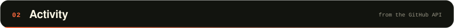

  
  

 

<a href="https://github.com/dwk601/kstack">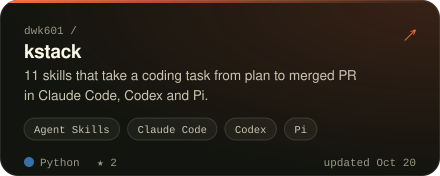</a>&nbsp;<a href="https://github.com/dwk601/koreer"></a>

<a href="https://github.com/dwk601/ga-health-inspect"></a>&nbsp;<a href="https://github.com/dwk601/takt_shift">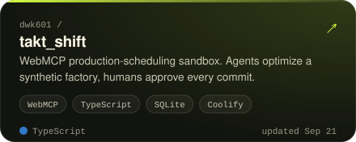</a>

<a href="https://github.com/dwk601/koreaJobApiV2">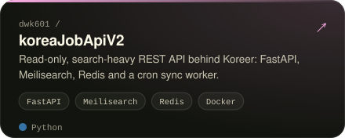</a>&nbsp;<a href="https://github.com/dwk601/penny">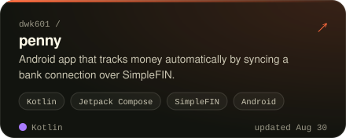</a>

Live: <a href="https://koreer.gongu.xyz/en">koreer.gongu.xyz</a> &nbsp;/&nbsp; <a href="https://ga-health.gongu.xyz/">ga-health.gongu.xyz</a> &nbsp;/&nbsp; <a href="https://github.com/dwk601?tab=repositories">all repositories</a>

 

- **[kstack](https://github.com/dwk601/kstack)** &middot; Port pstack updates into existing skills within size budget &middot; 1d ago
- **[YumGo](https://github.com/dwk601/YumGo)** &middot; test: scroll Analyze into view before tapping with IME up &middot; 3w ago
- **[takt_shift](https://github.com/dwk601/takt_shift)** &middot; feat: add umami analytics snippet &middot; 4w ago
- **[koreaRentalETL](https://github.com/dwk601/koreaRentalETL)** &middot; fix(compose): publish API on host port 8087 by default &middot; 4w ago
- **[koreer](https://github.com/dwk601/koreer)** &middot; test: retest coverage for the locale fix pass &middot; 4w ago

 

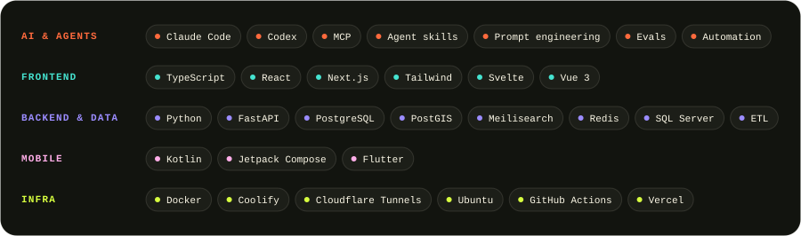

  

Stats and recent work refresh daily from the GitHub API. Last run 2026-10-22. <a href="scripts/generate.py">How it works</a>

