


 &nbsp; &nbsp; &nbsp;

 

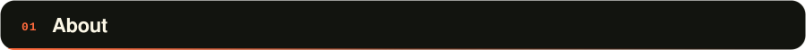

I build internal tools, custom ERP workflows and reporting automation. On my own time I ship self-hosted web apps and skills for coding agents.

- **Now.** I'm an AI Engineer at Alfrex USA, automating office work: email, intake, invoices and shipping tracking. Sample requests that took 10 to 15 minutes now take about one.
- **Studying.** M.S. in Data Science at Georgia Tech.
- **Building.** [kstack](https://github.com/dwk601/kstack) is a skill pack that takes a coding agent from plan to merged PR. [takt_shift](https://github.com/dwk601/takt_shift) is a WebMCP scheduling sandbox. I self-host my apps, including koreer and the GA health atlas, on gongu.xyz.
- **Before.** At Hyundai Mobis I built production dashboards and resolved 300+ MES data inconsistencies. At Mercor I evaluated frontier AI models. At Utah Valley University I moved the student portal from Vue 2 to Vue 3.

 

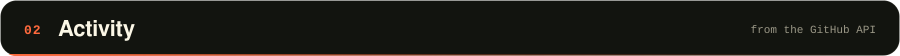

  
  

 

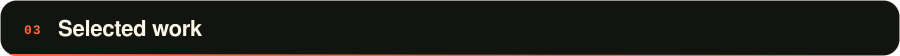

<a href="https://github.com/dwk601/kstack">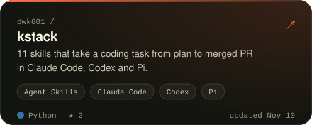</a>&nbsp;<a href="https://github.com/dwk601/koreer"></a>

<a href="https://github.com/dwk601/ga-health-inspect"></a>&nbsp;<a href="https://github.com/dwk601/takt_shift">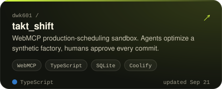</a>

<a href="https://github.com/dwk601/koreaJobApiV2">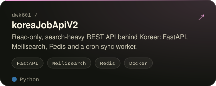</a>&nbsp;<a href="https://github.com/dwk601/penny">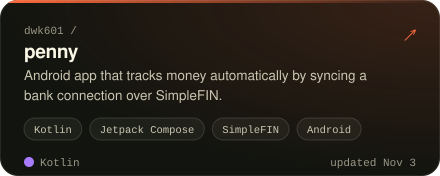</a>

Live: <a href="https://koreer.gongu.xyz/en">koreer.gongu.xyz</a> &nbsp;/&nbsp; <a href="https://ga-health.gongu.xyz/">ga-health.gongu.xyz</a> &nbsp;/&nbsp; <a href="https://github.com/dwk601?tab=repositories">all repositories</a>

 

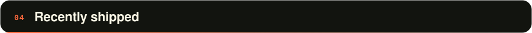

- **[ga-health-inspect](https://github.com/dwk601/ga-health-inspect)** &middot; Show GNR inspection history and report details &middot; 13h ago
- **[uscis_gongu](https://github.com/dwk601/uscis_gongu)** &middot; Fix mobile bulletin movement legend &middot; 1d ago
- **[ga_health_inspect_etl](https://github.com/dwk601/ga_health_inspect_etl)** &middot; Wait out GNR blocks during detail fetches and keep one session &middot; 2d ago
- **[kstack](https://github.com/dwk601/kstack)** &middot; Tighten efficiency safety contracts and CI concurrency advice &middot; 3d ago
- **[penny](https://github.com/dwk601/penny)** &middot; docs: add engineering standards to AGENTS.md &middot; 4d ago

 

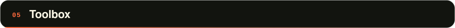

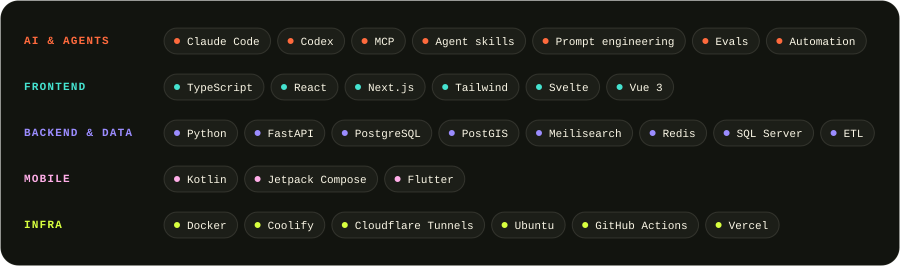

  

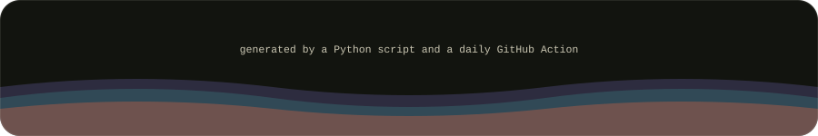

Last refreshed 2026-11-07. <a href="scripts/generate.py">How this page works</a>

